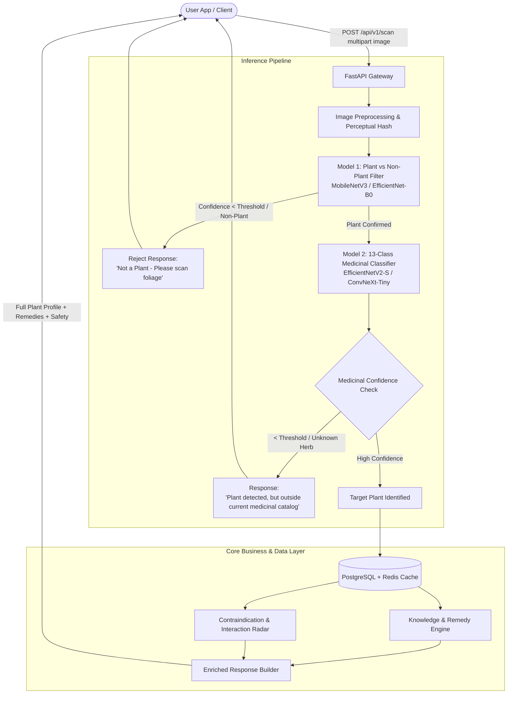

# MediPlant Backend Service Architecture & Innovation Plan

## 1. Executive Summary & Vision

**MediPlant** is an intelligent medicinal botany service designed to identify plants from imagery, filter out non-botanical noise, accurately classify medicinal species without third-party APIs, and empower everyday users to safely utilize natural remedies.

---

## 2. End-to-End System Architecture



---

## 3. Two-Stage Vision Intelligence Pipeline (No External APIs)

To maintain complete autonomy, privacy, zero API costs, and low latency (< 150ms per scan), the vision system is decoupled into two lightweight, on-premise models running via **ONNX Runtime** (optimized for CPU/GPU).

### Stage 1: Plant vs. Non-Plant Rejection Filter (Model 1)
* **Goal**: Reject random objects (faces, furniture, pets, vehicles, documents) immediately before wasting compute on detailed taxonomy.
* **Architecture**: Binary classifier based on **MobileNetV3-Small** or **SqueezeNet** (quantized INT8, size < 8 MB, latency ~10ms).
* **Training Data**: 
  - Class 0 (Non-Plant): Curated subsets of COCO / ImageNet (objects, people, household textures).
  - Class 1 (Plant/Foliage): Leaf, stem, flower, and bark samples from open botany sets (e.g., PlantVillage, Leafsnap).
* **Logic**: If `P(Plant) < 0.70`, return HTTP 422 with guided feedback: *"No plant detected. Ensure the camera focuses closely on leaves, flowers, or stems."*

### Stage 2: 13-Class Medicinal Plant Classifier (Model 2)
* **Target Species**:
  1. **Ashwagandha** (*Withania somnifera*)
  2. **Ayapana** (*Ayapana triplinervis*)
  3. **Gotu Kola** (*Centella asiatica*)
  4. **Rosemary** (*Salvia rosmarinus*)
  5. **Wood Apple** (*Limonia acidissima / Aegle marmelos*)
  6. **Moringa** (*Moringa oleifera*)
  7. **Tulsi** (*Ocimum tenuiflorum / Holy Basil*)
  8. **Neem** (*Azadirachta indica*)
  9. **Aloe Vera** (*Aloe barbadensis miller*)
  10. **Multi-Vitamin Plant / Chakra Muni** (*Sauropus androgynus*)
  11. **Amla** (*Phyllanthus emblica*)
  12. **Brahmi** (*Bacopa monnieri*)
  13. **Sarpagandha** (*Rauvolfia serpentina*)
* **Architecture**: **EfficientNetV2-S** or **ConvNeXt-Femto/Tiny** fine-tuned with transfer learning.
* **Safety & Out-of-Distribution (OOD) Guard**:
  - Softmax alone causes overconfidence on unknown species.
  - Implement **Temperature Scaling** or a **14th 'Other Wild Plant' class / Open-Set Recognition (Cosine Distance to prototype embeddings)**.
  - If the leaf is clearly a plant but doesn't match any of the 13 species with high confidence, notify the user honestly instead of guessing.

---

## 4. Innovative Value Propositions: Why Users Return to MediPlant

Beyond a simple "leaf scanner", the following 4 features transform MediPlant from a novelty scan tool into an essential daily health companion:

### 1. "Pantry-to-Medicine" Home Apothecary Engine
* **The Problem**: People identify plants around their garden, balcony, or neighborhood, but don't know what they can actually make with them right now.
* **The Solution**: 
  - Users maintain a "My Garden / My Herbs" virtual shelf.
  - **Dynamic Remedy Synthesizer**: The app tells them: *"With your Aloe Vera and Tulsi, you can make 3 preparations: (1) Soothing Sunburn Gel, (2) Anti-Acne Facial Toner, (3) Cold & Congestion Herbal Steam."*
  - Step-by-step visual preparation protocols (decoctions, infusions, pastes, poultices, oils).

### 2. "Contraindication & Drug Interaction Radar" (Crucial Safety Barrier)
* **The Problem**: People mistakenly assume "natural = 100% harmless." However:
  - *Sarpagandha* contains reserpine and can cause dangerous drops in blood pressure or interact with anti-hypertensives.
  - *Ashwagandha* can stimulate thyroid hormones and interacts with immunosuppressants and sedatives.
  - *Neem* and *Ayapana* have contraindications during pregnancy or bleeding disorders.
* **The Solution**:
  - Users can optionally save health profiles (e.g., "Pregnant / Lactating", "On Blood Thinners", "Hypertensive", "Diabetic").
  - Whenever a plant or remedy is searched or scanned, a real-time safety badge alerts them:
    - 🟢 **Safe for your profile**
    - 🟡 **Use with caution (Max 1 cup/day, consult practitioner)**
    - 🔴 **Contraindicated with your current medications/conditions**

### 3. "Reverse Symptom & Wellness Matchmaker"
* **The Problem**: Users don't always start with a leaf in hand; they start with an ailment (e.g., "brain fog", "insomnia", "indigestion", "hair fall", "dandruff", "joint pain").
* **The Solution**:
  - A semantic reverse search API.
  - Input: *"Stressed, trouble sleeping, mild knee inflammation"*.
  - Output: Ranked herbal recommendations (e.g., Ashwagandha for cortisol regulation, Gotu Kola for nervous system calm) with preparation dosage and traditional Ayurvedic dosha balancing notes (Vata, Pitta, Kapha).

### 4. "Visual Leaf Verification (Heatmap / Grad-CAM)"
* **The Problem**: Toxic lookalikes exist in the wild. Trusting a black-box percentage is risky when ingesting plants.
* **The Solution**:
  - The model outputs a Grad-CAM attention heatmap overlay.
  - The app highlights for the user: *"Matched primarily by characteristic leaf serration and venation pattern of Ocimum tenuiflorum (Tulsi). Check if your leaf has opposite decussate arrangement and faint aromatic scent."*

---

## 5. Recommended Backend Technology Stack

| Component | Technology | Rationale |
| :--- | :--- | :--- |
| **Backend Framework** | **Python (FastAPI)** | High performance (async ASGI), native compatibility with PyTorch/ONNX, automatic Swagger/OpenAPI documentation. |
| **Model Runtime** | **ONNX Runtime (CPU/DirectML/CUDA)** | 3-5x faster inference than raw PyTorch, small memory footprint (~200MB RAM), platform-agnostic. |
| **Database** | **PostgreSQL + SQLAlchemy 2.0 (Async)** | Stores botanical taxonomies, active constituents, remedies, contraindications, and user accounts. |
| **Caching & Rate Limiting** | **Redis** | Fast image perceptual hash lookup (skips neural inference if identical image scanned), session management. |
| **Image Pipeline** | **Pillow / OpenCV-Python / Albumentations** | Resizing, color normalization, and real-time contrast correction. |
| **Search Engine** | **pg_trgm / Full-Text Search (or pgvector)** | Fast multi-lingual plant name search (Botanical, English, Hindi, Sanskrit, Kannada, Tamil, etc.). |

---

## 6. Database Schema Design (Knowledge Engine)

```sql
-- Core plant catalog
CREATE TABLE plants (
    id UUID PRIMARY KEY DEFAULT gen_random_uuid(),
    slug VARCHAR(64) UNIQUE NOT NULL,
    botanical_name VARCHAR(128) NOT NULL,
    common_names JSONB NOT NULL, -- {"en": ["Holy Basil"], "hi": ["Tulsi"], "sa": ["Surasa"]}
    family VARCHAR(64),
    part_used TEXT[],            -- ['leaves', 'seeds', 'roots']
    active_compounds TEXT[],     -- ['Eugenol', 'Ursolic acid', 'Rosmarinic acid']
    ayurvedic_properties JSONB,  -- {"rasa": "Tikta", "virya": "Ushna", "vipaka": "Katu", "dosha": "Balances Vata & Kapha"}
    habitat_description TEXT,
    created_at TIMESTAMP WITH TIME ZONE DEFAULT NOW()
);

-- Medicinal applications & preparations
CREATE TABLE remedies (
    id UUID PRIMARY KEY DEFAULT gen_random_uuid(),
    plant_id UUID REFERENCES plants(id) ON DELETE CASCADE,
    ailment_category VARCHAR(64) NOT NULL, -- e.g., 'Respiratory', 'Skin', 'Cognitive', 'Digestion'
    condition_name VARCHAR(128) NOT NULL,  -- e.g., 'Cough & Cold', 'Mild Anxiety'
    preparation_type VARCHAR(64) NOT NULL, -- 'Infusion / Tea', 'Decoction (Kashayam)', 'Poultice / Paste', 'Juice (Swarasa)'
    instructions TEXT NOT NULL,
    dosage_guidelines TEXT NOT NULL,
    scientific_evidence_level VARCHAR(32) -- 'Traditional Use', 'Preclinical Evidence', 'Clinical Trials'
);

-- Contraindications & safety radar
CREATE TABLE safety_warnings (
    id UUID PRIMARY KEY DEFAULT gen_random_uuid(),
    plant_id UUID REFERENCES plants(id) ON DELETE CASCADE,
    severity VARCHAR(16) NOT NULL,         -- 'CRITICAL', 'MODERATE', 'PRECAUTION'
    contraindication_type VARCHAR(64),     -- 'PREGNANCY', 'HYPERTENSION', 'THYROID', 'DRUG_INTERACTION'
    description TEXT NOT NULL,
    interacting_pharmaceuticals TEXT[]
);

-- User's saved home garden / inventory
CREATE TABLE user_apothecary (
    id UUID PRIMARY KEY DEFAULT gen_random_uuid(),
    user_id UUID NOT NULL,
    plant_id UUID REFERENCES plants(id) ON DELETE CASCADE,
    nickname VARCHAR(64),
    plant_stage VARCHAR(32), -- 'SEEDLING', 'MATURE', 'DRIED_HERB'
    added_at TIMESTAMP WITH TIME ZONE DEFAULT NOW()
);
```

---

## 7. Implementation Roadmap & Milestones

### Phase 1: Machine Learning Model Development (Offline / Local)
1. **Dataset Assembly for 13 Classes**: Collect & clean ~250–500 diverse images per class (leaves, stems, lighting conditions, angles).
2. **Model 1 (Binary Filter)**: Fine-tune MobileNetV3 on `Plant vs Not-Plant`. Target: >98% accuracy.
3. **Model 2 (13 Species Classifier)**: Fine-tune EfficientNetV2 with augmentations (rotation, color jitter, cutout). Target: >95% top-1 accuracy.
4. **ONNX Export & Quantization**: Convert PyTorch `.pt` models to quantized `.onnx` for sub-50ms CPU execution.

### Phase 2: Core Backend Engine & API Architecture
1. **FastAPI Scaffolding**: Setup modular router, dependency injection, and async database connections.
2. **Inference Service**: Build the multi-stage pipeline (`/api/v1/identify`).
3. **Botanical Database Population**: Seed database with detailed pharmacological, Ayurvedic, preparation, and safety profiles for the 13 plants.

### Phase 3: Innovative Features Integration
1. **Ailment / Symptom Search API** (`/api/v1/remedies/search?symptom=...`).
2. **Safety Radar Check API** (`/api/v1/safety/check?plant_id=...&medications=...`).
3. **Apothecary Matcher API** (`/api/v1/apothecary/matches`).

### Phase 4: Validation & Testing
1. Test with real camera captures (varying backgrounds, hands holding leaves, sunlight, indoor shadows).
2. Stress test inference latency and concurrent requests.
